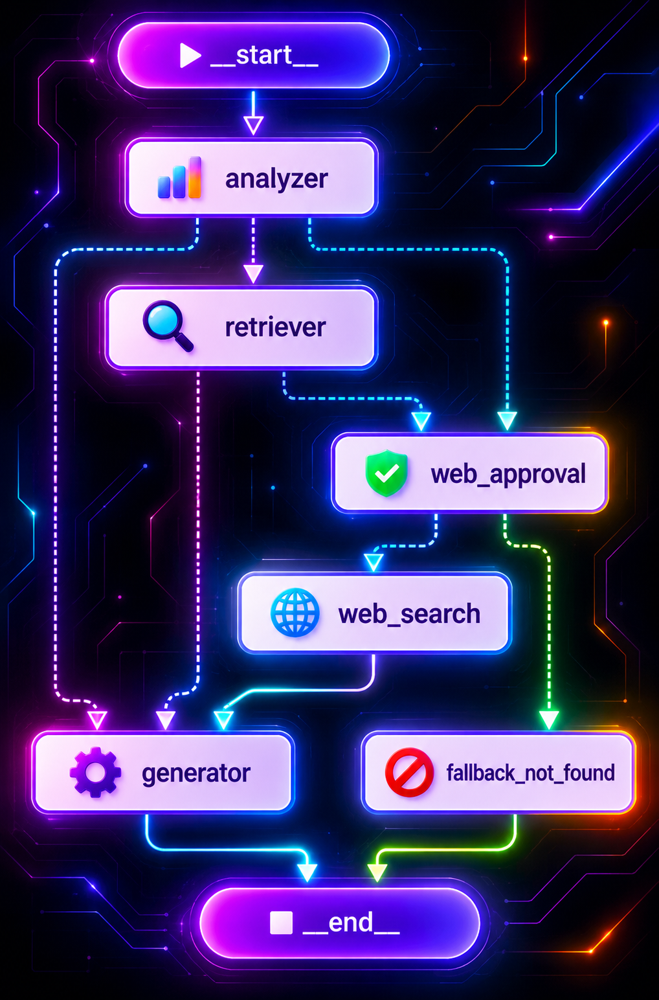
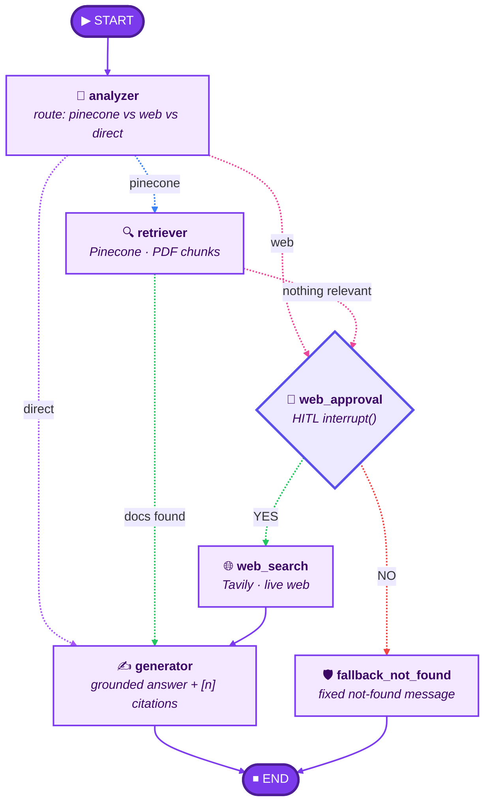

<div align="center">

# 🧭 RAG Router Agent — Agentic Workflow Architecture

**Per-question routing · Human-in-the-loop web consent · Exact-highlight citations**

<p>
  
  
  
  
  
  
</p>



</div>

---

## 📑 Contents

- [Overview](#-overview)
- [Graph](#-graph)
- [Node reference](#-node-reference)
- [Human-in-the-loop web consent](#-human-in-the-loop-web-consent)
- [Citation pipeline](#-citation-pipeline)
- [Node deep-dive](#-node-deep-dive)
- [Project structure](#-project-structure)
- [API](#-api-documents--chat)
- [Run locally](#-run-locally)
- [Notes](#-notes)

---

## ✨ Overview

A LangGraph agent that decides, **per question**, whether to answer from **your PDFs (Pinecone)**, from the **live web (Tavily)**, or **directly**. LLM and embeddings go through **OpenRouter**. Answers carry inline `[n]` citations that map to exact PDF highlight rectangles or web passages.

| Stage | What it guarantees |
| :-- | :-- |
| 🎯 Routing | Each question goes to the cheapest path that can answer it |
| 🔍 Retrieval | PDF-first: your documents are searched before anything leaves your machine |
| 🛑 Consent | Live web search never runs without an explicit **YES** from the user |
| 🛡️ Fallback | A **NO** ends the run with a fixed, honest "not found" message |
| ✍️ Generation | Every grounded sentence cites `[n]`; hallucinated numbers are stripped |

---

## 🗺️ Graph



> [!TIP]
> **Legend:** dotted arrows = conditional edges (routing decisions) · solid arrows = fixed edges · 🔵 PDF route · 🩷 path into web approval · 🟢 accepted / approved · 🔴 user declined

---

## 🧩 Node reference

| # | Node | Role | Key technique |
| :-: | :-- | :-- | :-- |
| 1 | 🎯 **analyzer** | Pick the runtime path | Router prompt · `pinecone` / `web` / `direct` |
| 2 | 🔍 **retriever** | Fetch relevant PDF chunks | Pinecone · `RETRIEVAL_MIN_SCORE` threshold |
| 3 | 🛑 **web_approval** | Ask permission before any web call | LangGraph `interrupt()` · `AsyncSqliteSaver` |
| 4 | 🌐 **web_search** | Live fallback | Tavily |
| 5 | 🛡️ **fallback_not_found** | Safe stop when the user says NO | Fixed message, no LLM call |
| 6 | ✍️ **generator** | Grounded answer with citations | `[n]` markers · `citation_filter` |

**Routing table**

| From | To | Condition |
| :-- | :-- | :-- |
| `analyzer` | `retriever` | question concerns your PDFs |
| `analyzer` | `web_approval` | question needs live web data |
| `analyzer` | `generator` | direct answer, no retrieval needed |
| `retriever` | `generator` | relevant documents found |
| `retriever` | `web_approval` | nothing relevant (or scores below `RETRIEVAL_MIN_SCORE`) |
| `web_approval` | `web_search` | user answers **YES** |
| `web_approval` | `fallback_not_found` | user answers **NO** |
| `web_search` | `generator` | always |
| `generator` · `fallback_not_found` | `END` | always |

---

## 🛑 Human-in-the-loop web consent

Any path into live web search pauses the graph before a single external call is made.

```text
 question ──► analyzer / retriever ──► web_approval ── interrupt() ──► graph paused
                                                          │
                              state saved in data/checkpoints.db (AsyncSqliteSaver)
                                                          │
                       UI shows glassmorphism confirmation modal
                                                          │
              POST /api/chat/resume { thread_id, decision } ──┬── YES ──► web_search ──► generator
                                                              └── NO  ──► fallback_not_found
```

- 💾 The checkpointer (`data/checkpoints.db`) is opened in the FastAPI lifespan.
- 🔁 Chat and resume use `astream` / `aget_state` only.
- 🪟 The `interrupt` SSE event carries `{ thread_id, type, message, search_query, reason, route, t }`.
- 🛡️ On **NO** the fixed answer is: *"I could not find this information in your provided PDF documents."*

---

## 📎 Citation pipeline

**Indexing**

```text
 Upload PDF
   ├─► save bytes to data/uploads/{doc_id}.pdf
   ├─► PyPDFLoader (one Document per page) + RecursiveCharacterTextSplitter
   ├─► pdf_locator aligns each chunk to pdfplumber word boxes
   ├─► sidecar data/chunks/{doc_id}.json  ({chunk_index -> page, rects[], match_quality, page_w/h})
   └─► embeddings upserted to Pinecone (id = {doc_id}#{chunk_index}; no rects in metadata)
```

**Answering**

```text
 Ask a question
   ├─► retriever / web_search emit numbered sources (n is 1-based, PDF first then web)
   ├─► generator must cite every grounded sentence with [n]
   ├─► citation_filter strips hallucinated numbers from the final answer and the SSE token stream
   ├─► done event includes used_citations + citations_valid
   └─► frontend chips open the Source Viewer: jump to page, center the rect, pulse highlight
```

Rectangles are normalized `0..1` relative to page width/height (origin top-left): `{x, y, w, h}`. If `match_quality < 0.6`, `rects` is empty and the UI falls back to text-layer search on that page.

> [!NOTE]
> Documents indexed before file storage have `has_file: false` on `GET /api/documents`. The UI should prompt a re-upload for page preview.

---

## 🔬 Node deep-dive

<details>
<summary><b>🎯 1. Analyzer — the router</b></summary>

<br>

- Entry point of the graph; driven by `prompts/router_prompt.py`.
- Chooses one of three routes: `pinecone` (your PDFs), `web` (live data), or `direct` (no retrieval).
- The decision streams to the UI as a `route` SSE event.

</details>

<details>
<summary><b>🔍 2. Retriever — PDF-first search</b></summary>

<br>

- Queries Pinecone (cosine, serverless) with embeddings from OpenRouter.
- Emits numbered sources (`type, n, doc_id, chunk_index, title, page, score, snippet, text, rects, page_width, page_height, match_quality`).
- If nothing relevant is found, or scores fall below `RETRIEVAL_MIN_SCORE`, the run is sent to `web_approval` instead of the generator.

</details>

<details>
<summary><b>🛑 3. Web approval — the consent gate</b></summary>

<br>

- Calls LangGraph `interrupt()` and persists state through `AsyncSqliteSaver`.
- Resumes only through `POST /api/chat/resume` with `YES` or `NO`.
- Nothing is sent to Tavily until the user approves.

</details>

<details>
<summary><b>🌐 4. Web search — Tavily</b></summary>

<br>

- Runs only after an explicit **YES**.
- Web sources are numbered after the PDF sources, so `[n]` stays unique across both.

</details>

<details>
<summary><b>🛡️ 5. Fallback not found — safe stop</b></summary>

<br>

- Triggered by a **NO** decision.
- Returns the fixed message and ends the graph, with no LLM call and no web call.

</details>

<details>
<summary><b>✍️ 6. Generator — grounded synthesis</b></summary>

<br>

- Cites every grounded sentence with `[n]` (`prompts/generator_prompt.py`).
- `citation_filter` strips hallucinated numbers from both the final answer and the SSE token stream.
- The `done` event reports `used_citations` and `citations_valid`.

</details>

---

## 🗂️ Project structure

```text
backend/app/
  agent/        state.py, graph.py, edges.py, checkpointer.py, citation_filter.py,
                nodes/{analyzer,retriever,web_approval,web_search,fallback_not_found,generator}.py
  prompts/      router_prompt.py, generator_prompt.py
  routes/       chat.py (SSE + resume), documents.py, health.py
  services/     pdf_service.py, pdf_locator.py, vectorstore.py,
                tavily_service.py, document_registry.py
  llm/          client.py (OpenRouter chat + embeddings)
  schemas/      request/response models
  core/         config.py, logging.py
frontend/
  public/       graph.png
  src/
    app/          layout, page, globals.css
    components/   Sidebar, FileDropzone, DocumentList, ChatWindow, MessageBubble,
                  RouteTrace, SourceList, ChatInput, WebSearchModal
    store/        chat-store.ts, document-store.ts (Zustand)
    lib/          api.ts (SSE streaming client), types.ts
```

---

## 🔌 API (documents & chat)

| Method | Path | Notes |
| :-: | :-- | :-- |
| `GET` | `/api/documents` | List docs; each includes `has_file` |
| `POST` | `/api/documents/upload` | Store PDF + index + sidecar |
| `GET` | `/api/documents/{doc_id}/file` | Original PDF (`application/pdf`, inline, Range via FileResponse) |
| `DELETE` | `/api/documents/{doc_id}` | Registry + vectors + file + sidecar |
| `POST` | `/api/chat` | SSE: `route` \| `step` \| `sources` \| `token` \| `interrupt` \| `done` \| `error` |
| `POST` | `/api/chat/resume` | Body `{ thread_id, decision: "YES"\|"NO" }` — resume after HITL interrupt |

`interrupt` payload: `{ thread_id, type, message, search_query, reason, route, t }`
`done` payload: `{ thread_id, used_citations: number[], citations_valid: boolean, t }`

---

## 🚀 Run locally

**Requirements:** Python 3.11+, Node 20+

```bash
# backend
cd backend
python -m venv .venv && source .venv/bin/activate   # Windows: .venv\Scripts\activate
pip install -r requirements.txt
cp .env.example .env        # fill OPENROUTER_API_KEY, PINECONE_API_KEY, TAVILY_API_KEY
uvicorn app.main:app --reload --port 8000

# frontend (second terminal)
cd frontend
npm install
cp .env.example .env.local
npm run dev                 # http://localhost:3000
```

Or with Docker: `docker compose up --build` (after creating `backend/.env`).

**Tests**

```bash
cd backend
pytest
```

---

## 📌 Notes

- The Pinecone index is created automatically on first start (cosine, serverless). `EMBEDDING_DIMENSION` must match the embedding model (1536 for `openai/text-embedding-3-small`).
- Router decisions, steps and sources stream to the UI over SSE (`route`, `step`, `sources`, `token`, `done`, `error`). Event payloads may gain fields; existing names stay stable.
- If retrieval scores fall below `RETRIEVAL_MIN_SCORE`, the agent routes to web approval (and to Tavily only after consent).
- Highlight geometry uses **pdfplumber** (MIT). Do not swap in PyMuPDF (AGPL) for client-shipped builds.
- Scanned PDFs have no text layer and need OCR first; alignment quality will be low and `rects` empty.
- Documents are shared in one Pinecone namespace; add per-user namespaces + auth before multi-tenant use.
